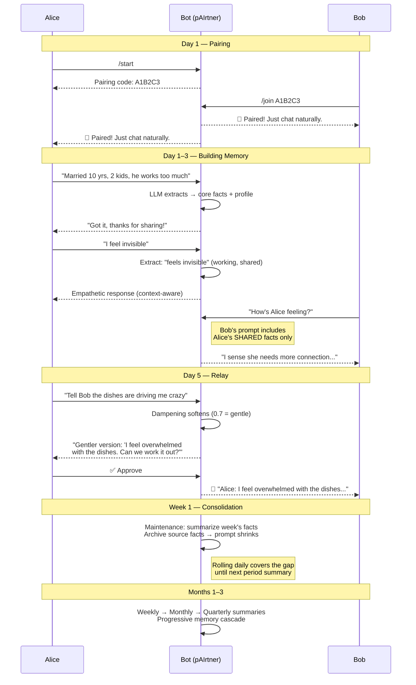
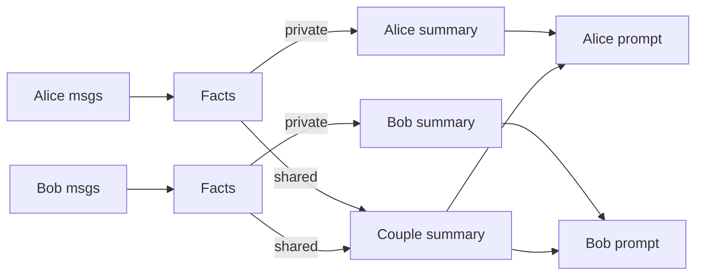

# pAIrtner

A private AI mediator for couples. Each partner chats privately with the bot — it softens messages, learns your communication style, and only passes along what you approve.

## Why

- **Privacy is structural** — partner data isolation is enforced at the SQL level, not prompt instructions. The LLM never sees your partner's raw messages.
- **Culturally adaptive** — learns your natural register (Telugu, Hindi, casual English, etc.) and matches it. No hardcoded Western therapy-speak.
- **Data is yours** — conversations stored locally in SQLite. LLMs are replaceable; your relationship history is the product.
- **Progressively useful** — teaches you to communicate better over time.

## Quick Start

```bash
git clone https://github.com/ksrikanthcnc/pAIrtner.git && cd pAIrtner
uv sync
```

### Local dev (auto-detects Ollama + Gemini)

```bash
ollama pull qwen3:8b
uv run python dev/localtest/run_local.py --keep
# Open http://127.0.0.1:8766/duo_keep.html (persistent duo, /start + /join)
# Open http://127.0.0.1:8766/ (single-user PWA)
```

The `--llm` flag defaults to `auto` — it probes Ollama (localhost:11434) and checks `GEMINI_API_KEY`. Both can be active simultaneously:

```bash
# Both providers: Ollama primary, Gemini via /model gemini:flash-2
GEMINI_API_KEY=your-key uv run python dev/localtest/run_local.py --keep

# Gemini only:
GEMINI_API_KEY=your-key uv run python dev/localtest/run_local.py --keep --llm gemini

# Fake LLM (deterministic, no API costs, for testing):
uv run python dev/localtest/run_local.py --llm fake

# Smaller model for low-end hardware (4GB VRAM):
LOCAL_MODEL=gemma3:4b uv run python dev/localtest/run_local.py --keep --pack simple
```

### Production (Telegram)

```bash
cp .env.example .env   # Set TELEGRAM_BOT_TOKEN and GEMINI_API_KEY
uv run python -m pairtner
```

### Docker

```bash
docker compose up -d
```

## How It Works



## A Week with pAIrtner — API Detail

```
Day 1 — Pairing
═══════════════════════════════════════════════════════════════

POST /api/v1/message  { text: "/start" }                     ← Alice
→ 200 { replies: ["Your pairing code is: A1B2C3"] }
                                                              DB: users(1, 'Alice', partner=NULL)

POST /api/v1/message  { text: "/join A1B2C3" }               ← Bob
→ 200 { replies: ["🎉 You're paired! Just chat naturally."] }
                                                              DB: users(2, 'Bob', partner=1)
                                                              DB: relationships(id='1_2', user_a=1, user_b=2)
                                                              DB: timeline_events(type='paired')

Day 1 — First Messages
═══════════════════════════════════════════════════════════════

POST /api/v1/message  { text: "Married 10 years, 2 kids,     ← Alice
     he works too much" }
  Engine:
    1. Onboarding: LLM extracts → {married, 10yr, 2 kids}
    2. Stores in user_profiles + core facts
→ 200 { replies: ["Got it, thanks for sharing!"] }
                                                              DB: facts(owner=1, kind='core', text='Married 10 years')
                                                              DB: facts(owner=1, kind='core', text='Has 2 kids')
                                                              DB: user_profiles(duration_years=10, has_kids=1)

POST /api/v1/message  { text: "I feel invisible" }           ← Alice
  Engine:
    1. Build prompt:
       SYSTEM = persona.md + contract.md + voice + dampening
       USER   = core_facts(2) + working_facts(0) + partner_shared(0)
              + summaries(0) + recent_msgs(2) + current_message
    2. LLM → { reply: "That sounds painful...",
                new_facts: [{text: "feels invisible", vis: "shared"}] }
    3. Semantic dedup check → no duplicate → store
→ 200 { replies: ["That sounds painful..."] }
                                                              DB: facts(owner=1, kind='working', text='feels invisible')
                                                              DB: messages(user=1, role='user', content='I feel invisible')
                                                              DB: messages(user=1, role='assistant', content='That sounds...')

Day 2 — Bob chats (sees Alice's shared facts)
═══════════════════════════════════════════════════════════════

POST /api/v1/message  { text: "How's Alice feeling?" }       ← Bob
  Engine:
    1. Build prompt for Bob:
       USER = Bob's core_facts + Bob's working_facts
            + ALICE'S SHARED facts → ["feels invisible"]     ← cross-partner
            + nudge_suggestions(0) + summaries(0)
            + recent_msgs(1) + current_message
    2. LLM responds with awareness of Alice's shared context
       but NEVER reveals Alice's private facts
→ 200 { replies: ["I can't share specifics, but I sense..."] }

Day 3 — Relay (softened message delivery)
═══════════════════════════════════════════════════════════════

POST /api/v1/message  { text: "Tell Bob the dishes are       ← Alice
     driving me crazy" }
  Engine:
    1. LLM detects relay intent → relay_draft generated
    2. relay_urgency = "info" → auto-becomes a nudge (no approval needed)
       OR urgency = "important" → asks for approval
  For "important":
→ 200 { replies: ["Here's a gentler version: 'I've been
     overwhelmed with the dishes. Can we figure it out?'"],
     buttons: [{id: "approve"}, {id: "edit"}, {id: "cancel"}] }

POST /api/v1/callback  { data: "approve:abc123" }            ← Alice approves
                                                              DB: relay_queue(draft=..., status='approved',
                                                                  send_after=now+15min)

  ... 15 min cooldown, delivery loop fires ...

GET /api/v1/events  (SSE long-poll)                           ← Bob's PWA
→ event: { type: "relay", text: "💌 Alice: I've been
     overwhelmed with dishes..." }

Day 7 — Weekly Consolidation (background)
═══════════════════════════════════════════════════════════════

  Memory maintenance loop (every 1hr):
    1. Gather all working+episode facts from past 7 days
    2. Group by tag (family, work, feelings)
    3. LLM writes summary per tag
    4. Store as kind='weekly' facts

                                                              DB: facts(kind='weekly', text='Alice feeling unseen amid
                                                                  Bob work stress. Flowers gesture noted. Dishes
                                                                  tension surfaced, relay sent.')

  What's in Alice's prompt now:
    core_facts:    ["Married 10 years", "2 kids"]
    working_facts: ["feels invisible", "dishes tension"]
    summaries:     ["(weekly) Alice feeling unseen amid..."]  ← rolled up
    partner_shared:["Bob stressed from work", "bought flowers"]
    recent_msgs:   [last 6 exchanges]

Month 1 — Monthly Rollup
═══════════════════════════════════════════════════════════════

  Weekly summaries → LLM consolidates → monthly summary
                                                              DB: facts(kind='monthly', text='November: communication
                                                                  improving, dishes resolved, date nights started...')

  Prompt now has: core + working + weekly + monthly summaries
  (each level = ONE entry in the summaries section)

Quarter — Quarterly Rollup
═══════════════════════════════════════════════════════════════

  Monthly summaries → quarterly summary
  Prompt carries: core + latest working + weekly + monthly + quarterly
  Total context: ~2000-4000 words, capped per section
```

## Features

- **Relay drafting** — softens messages before they reach your partner (`#send`, `/tell`)
- **Memory system** — extracts facts, ages them naturally, consolidates into summaries (weekly→monthly→quarterly). Never auto-outdates working facts.
- **Multi-provider LLM** — Ollama and Gemini simultaneously. Switch on the fly with `/model gemini:flash-2` or `/model qwen3:8b`.
- **Semantic dedup** — catches duplicate facts and contradictions automatically
- **Multiple voices** — casual English, Telugu, Hindi, formal English. Learns your style over time.
- **Persona tuning** — adapts tone based on accumulated interaction patterns
- **Mood tracking** — adjusts response style based on emotional state
- **Weekly check-ins** — prompted reflection for both partners
- **Conflict detection** — spots recurring patterns (Gottman's Four Horsemen)
- **Chat import** — bulk import from WhatsApp, Telegram, or JSON exports
- **PWA** — installable web app with real-time SSE, chat history, knowledge browser, relationship dashboard
- **Prompt packs** — all behavior in markdown files, swappable without code changes. Simple pack for 4B models.
- **Admin dashboard** — conversation viewer, SQL explorer, stats, dry-run testing
- **Push notifications** — Web Push API (VAPID), works behind NAT
- **Therapy export** — prose-format export for therapy sessions

## Commands

| Command | What it does |
|---------|-------------|
| `/start` | Get a pairing code |
| `/join <code>` | Pair with your partner |
| `/forget <text>` | Delete matching facts |
| `/share <tag>` | Make facts with tag shared |
| `/private <tag>` | Make facts with tag private |
| `/search <query>` | Two-pass search (FTS5 → LLM rerank) |
| `/goal <text>` | Set personal/shared goals |
| `/settings [key] [value]` | View/change preferences (sharing, nudges, quiet hours) |
| `/mode <vent\|relay\|coach>` | Set interaction mode |
| `/model <name>` | Switch model (`gemini:flash-2`, `qwen3:8b`, `reset`) |
| `/rewrite` | LLM rewrites working facts for clarity |
| `/export therapy` | Prose export for therapy sessions |
| `/debug <msg>` | Show raw LLM input/output |
| `/dryrun <msg>` | Test without saving to DB |
| `/warnings` | Show system health warnings |
| `/topics` | Browse facts by topic tag |
| `/history [n]` | Recent messages |
| `/status` | Your memory stats |
| `/usage [days]` | LLM usage stats |
| `/password <pw>` | Set PWA login password |
| `/pause` / `/resume` | Pause/resume relay delivery |
| `/help` | Full command list |

**Tags** (in regular messages): `#keep` (save fact), `#send` (draft relay), `#blunt` (honest feedback), `#deep` (heavy model)

## Privacy Model

- **Two levels.** Each fact is `private` (only the owner sees it; no partner nudges, no couple summary) or `shared` (default; partner context and nudges allowed).
- **Sharing mode.** Chosen at onboarding, changeable with `/settings sharing`: *Open* (default shared), *Ask* (shared, ask on grey areas), *Private* (default private).
- **You decide.** Nothing is auto-private. Say "keep this private" or use `/private <tag>` / `/share <tag>`; a per-fact choice beats the tag default.
- **Isolated summaries.** Alice-private, Bob-private and couple-shared summaries are kept separate, so private facts never shape what the partner sees.



## Push Notifications

PWA push via the Web Push API (VAPID + pywebpush). The bot only makes outbound HTTPS calls, so it works behind NAT, and from anywhere after a one-time subscription on the LAN.

## Deployment

Runs as a Docker container on a WSL host. Deploy from the Mac with `push-win.sh` (SCP, no git on the wire). Code lives in `~/docker/pairtner/`, state in `~/docker/appdata/pairtner/`, REST API on port 8180. See [DEPLOYMENT.md](DEPLOYMENT.md).

## Prompt Packs

All bot behavior is defined in markdown files — no code changes needed. Create a custom pack for different use cases (father-son, roommates, debate partner).

```
packs/default/          # Stock pack
packs/template/         # Starter template for custom packs
```

See [docs/PACKS.md](docs/PACKS.md) for the authoring guide.

## Documentation

| Doc | Contents |
|-----|----------|
| [docs/FULL-FLOW.md](docs/FULL-FLOW.md) | **End-to-end system walkthrough** — startup, pairing, conversation, memory, relay |
| [ARCHITECTURE.md](ARCHITECTURE.md) | System architecture, module map, memory lifecycle |
| [DESIGN.md](DESIGN.md) | Design philosophy and decisions |
| [docs/CORE-DESIGN.md](docs/CORE-DESIGN.md) | Pack system, memory engine, pluggability |
| [docs/MEMORY-DESIGN.md](docs/MEMORY-DESIGN.md) | Memory kinds, ops, aging, context budget |
| [docs/REST_API.md](docs/REST_API.md) | REST API reference |
| [docs/PACKS.md](docs/PACKS.md) | Prompt pack authoring guide |
| [DEPLOYMENT.md](DEPLOYMENT.md) | Hosting guides (Docker, Oracle Cloud, Tailscale) |
| [CONTRIBUTING.md](CONTRIBUTING.md) | How to contribute |
| [docs/DECISIONS.md](docs/DECISIONS.md) | Design decision log |

## License

MIT — see [LICENSE](LICENSE).
