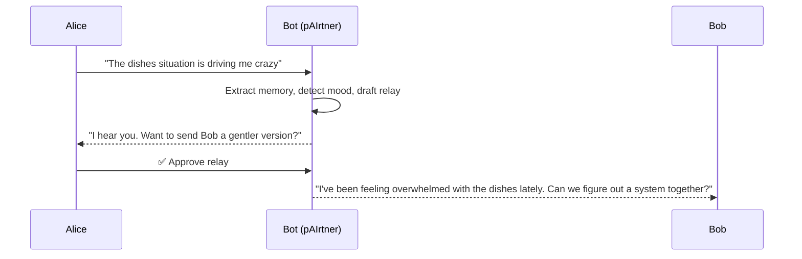
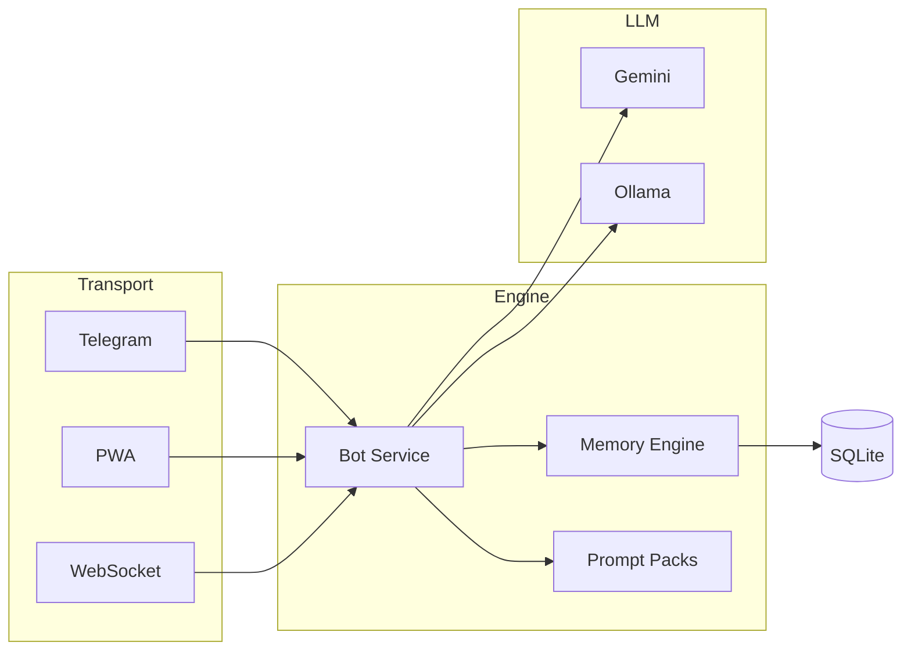

# pAIrtner

A private AI mediator for couples. Each partner chats privately with the bot — it softens messages, learns your communication style, and only passes along what you approve.

## Why

- **Privacy is structural** — partner data isolation is enforced at the SQL level, not prompt instructions. The LLM never sees your partner's raw messages.
- **Culturally adaptive** — learns your natural register (Telugu, Hindi, casual English, etc.) and matches it. No hardcoded Western therapy-speak.
- **Data is yours** — conversations stored locally in SQLite. LLMs are replaceable; your relationship history is the product.
- **Progressively useful** — teaches you to communicate better over time.

## Quick Start

```bash
git clone https://github.com/ksrikanthcnc/pAIrtner.git && cd pAIrtner
uv sync
cp .env.example .env   # Set TELEGRAM_BOT_TOKEN and GEMINI_API_KEY
uv run python -m pairtner
```

### Local testing (no API keys needed)

```bash
uv run python dev/localtest/run_local.py --llm fake     # http://127.0.0.1:8766
# Open http://127.0.0.1:8766/duo.html for side-by-side Alice + Bob
```

### With Ollama (local LLM, no API costs)

```bash
ollama pull qwen3:8b
uv run python dev/localtest/run_local.py --llm ollama   # http://127.0.0.1:8766
```

### Docker

```bash
docker compose up -d
```

## How It Works





## Features

- **Relay drafting** — softens messages before they reach your partner (`#send`)
- **Memory system** — learns facts about you, ages them naturally, never shares private ones
- **Multiple voices** — casual English, Telugu, Hindi, formal English
- **Mood tracking** — adjusts tone based on your emotional state
- **Weekly check-ins** — prompted reflection for both partners
- **Conflict detection** — spots recurring patterns (Gottman's Four Horsemen)
- **PWA** — installable web app, works offline, syncs chat history
- **Admin dashboard** — conversation viewer, config editor, stats

## Commands

| Command | What it does |
|---------|-------------|
| `/start` | Get a pairing code |
| `/join <code>` | Pair with your partner |
| `/tell <msg>` | Draft a gentle relay |
| `/whatdoyouknow` | See what the bot remembers |
| `/review` | Review and correct core memories |
| `/mediate` | Neutral perspective on shared issues |
| `/mood <mood>` | Set mood (stressed, happy, angry, reflective) |
| `/vibe` | View learned voice profile |
| `/help` | All commands |

**Tags** (in regular messages): `#keep` (save fact), `#send` (draft relay), `#blunt` (honest feedback), `#deep` (heavy model)

## Prompt Packs

All bot behavior is defined in markdown files — no code changes needed. Create a custom pack for different use cases (father-son, roommates, debate partner).

```
packs/default/          # Stock pack
packs/template/         # Starter template for custom packs
```

See [docs/PACKS.md](docs/PACKS.md) for the authoring guide.

## Documentation

| Doc | Contents |
|-----|----------|
| [ARCHITECTURE.md](ARCHITECTURE.md) | System architecture, module map, memory lifecycle |
| [DESIGN.md](DESIGN.md) | Design philosophy and decisions |
| [docs/CORE-DESIGN.md](docs/CORE-DESIGN.md) | Pack system, memory engine, pluggability |
| [docs/MEMORY-DESIGN.md](docs/MEMORY-DESIGN.md) | Memory kinds, ops, aging, context budget |
| [docs/REST_API.md](docs/REST_API.md) | REST API reference |
| [docs/PACKS.md](docs/PACKS.md) | Prompt pack authoring guide |
| [DEPLOYMENT.md](DEPLOYMENT.md) | Hosting guides (Docker, Oracle Cloud, Tailscale) |
| [CONTRIBUTING.md](CONTRIBUTING.md) | How to contribute |
| [docs/DECISIONS.md](docs/DECISIONS.md) | Design decision log |

## License

MIT — see [LICENSE](LICENSE).
